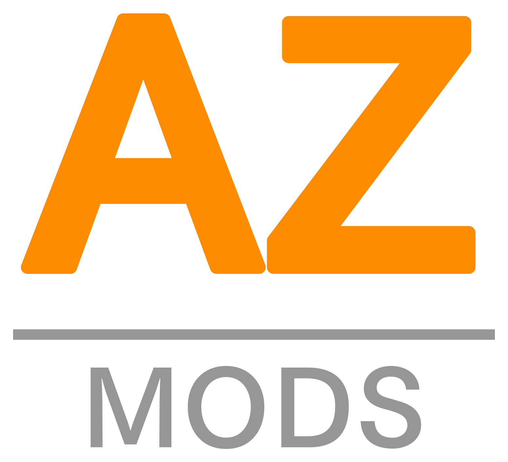
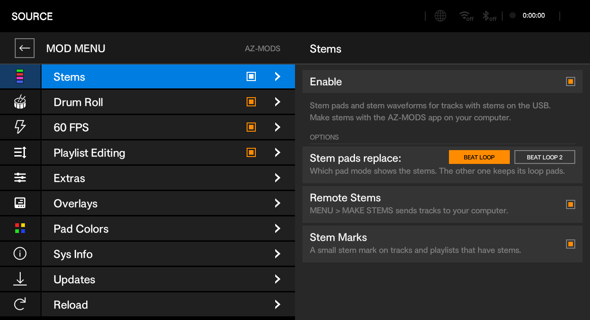
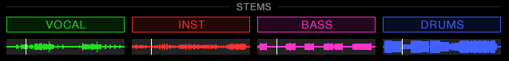
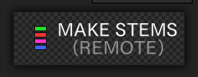
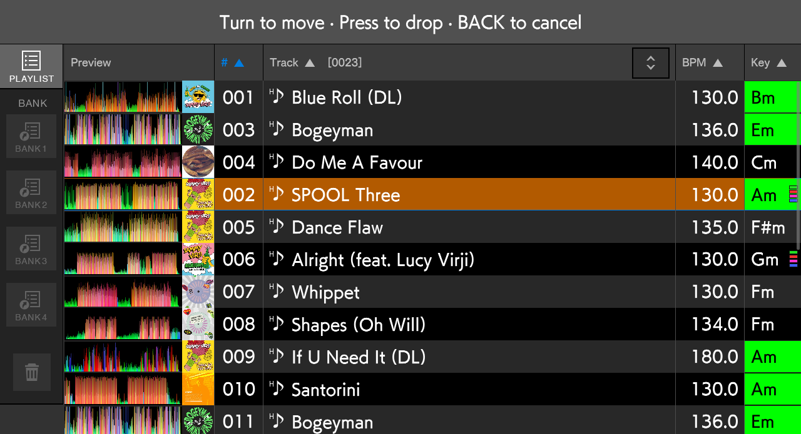
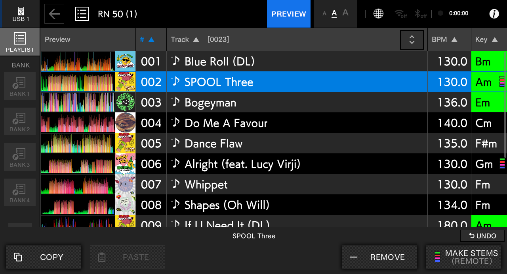
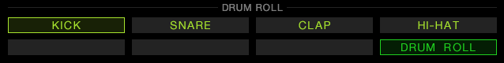
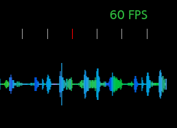
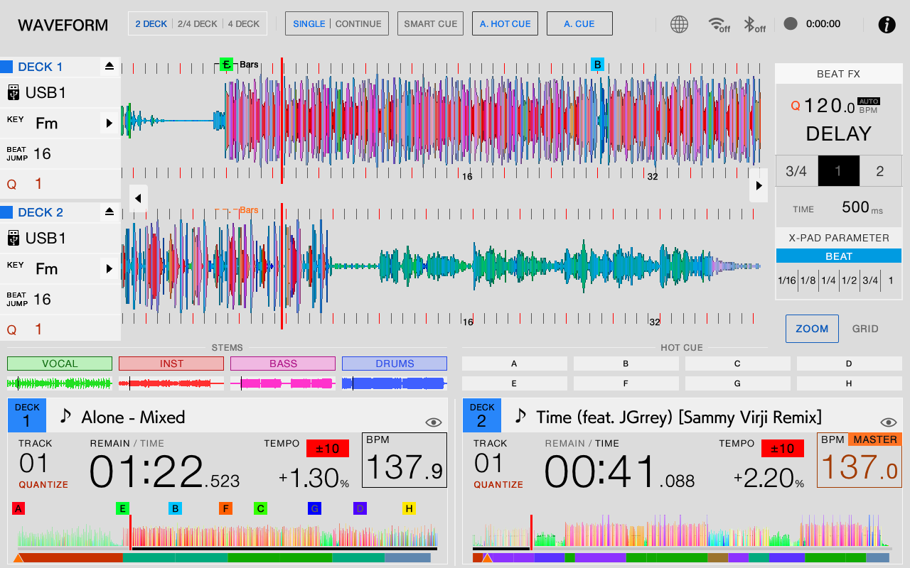

<div align="center">




**Root Access & Mods for the XDJ-AZ**

[](../../releases)
[](#install)
[](../../releases)
[](LICENSE)
[](https://discord.gg/SGBxQPK24J)

[**Download**](../../releases) · [Install](#install) · [Features](#features) · [How it works](#how-it-works) · [Safety](#safety) · [FAQ](#faq) · [Community Mods](#community-mods) · [Source code](#source-code) · [Developers](#developers) · [**Discord**](https://discord.gg/SGBxQPK24J)

</div>

<br>

> [!CAUTION]
> This modifies your XDJ-AZ's firmware. I've tested it on my own hardware and the
> chance of bricking is low, but it is not zero: the only real danger is losing power
> during the firmware flash, so don't unplug the deck until the update has
> finished.\
> **USE AT YOUR OWN RISK.**

<br>

## Install

> [!NOTE]
> Before you start, download the stock **XDJAZv200.UPD** (firmware 2.00) from
> the official support site.
> ALSO, make sure the USB you're using to flash the modded firmware is
> formatted to <b>FAT32</b>.

1. **Get the AZ-MODS desktop app** (Mac or Windows) from the [releases page](../../releases).

2. **Patch the firmware (once).** In the desktop app, open the *Install* tab,
   drop in your stock `.UPD`, select your USB stick and click
   **Build & write to USB**. This builds AZ-MODS firmware **2.01**. On the deck: power off, put the USB in
   **USB 1**, hold **deck 2's BEAT SYNC + MASTER** while powering on, and run
   the update.

3. **Choose your mods.** Select your music USB in the desktop app, tick the
   mods you want and click **Install to USB**. Boot the deck with that USB
   in and the mods load. Boot with a USB that has no mods, or no USB at
   all, and the deck is stock.

4. **Make stems, add samples.** Right-click tracks or playlists in the desktop
   app to render stems, and add your drum samples to a bank. Eject and play.

Mod updates only change the files in the `MODS` folder on your USB. Get them from
the desktop app or from **Updates** in the Mod Menu; an update installed on the deck
applies at the next reload (the deck never restarts by itself while a track is
loaded). After the first firmware flash you shouldn't ever have to flash again.

> [!NOTE]
> When the mod loader loads mods for the first time, or after an update, you will see a
> **black screen** after the deck boots. **This is normal**: wait a few seconds while it
> loads the mods.

<br>

## Uninstall

**Just want the deck stock for a gig?** Boot without the USB, or flip
*Disable mods* for your USB in the desktop app and power-cycle. Nothing else
is needed.

**Removing AZ-MODS completely:**

1. **Clean the deck first, while it's still on the modded firmware.** In the
   desktop app, open *Install / Uninstall*, select your USB stick, and under
   **Uninstall** tick **Uninstall AZ-MODS from the deck on the next
   power-cycle**.

2. **Power-cycle the deck with that USB in USB 1.** On this boot the deck
   removes every AZ-MODS file it stored.

3. **Check the result.** Put the USB back in your computer. The app shows
   **No AZ-MODS files remain on the deck. You can now flash the stock
   firmware.** If it lists anything still on the deck, leave the box ticked
   and power-cycle once more.

4. **Flash the stock firmware.** Put the stock `XDJAZv200.UPD` on a USB stick
   and flash it the same way you installed: power off, USB in **USB 1**,
   hold **deck 2's BEAT SYNC + MASTER** while powering on, and run the update.

Your deck is now exactly as it started before modding.

<br>

## Features

| Mod | What it does |
|:--|:--|
| [**Mod Menu**](#mod-menu) | Every mod and its settings in one full-screen menu, right from the deck's SOURCE list |
| [**Stems**](#stems) | VOCAL · MELODY · BASS · DRUMS on the pads, through the deck's native audio path |
| [**Remote Stems**](#remote-stems) | Make stems for a track or a whole playlist from the deck, sent to your computer over WiFi |
| [**Playlist Editing**](#playlist-editing) | Move, copy, paste, rename and remove tracks, playlists and folders on the deck |
| [**Drum Roll**](#drum-roll) | A sample roll instrument on the X-PAD, locked to the deck's BPM |
| [**60 FPS Waveforms**](#60-fps-waveforms) | Lifts the stock ~30 FPS waveform cap to 60 |
| [**Themes**](#themes) | A light Day theme for bright rooms, plus four dark color themes |
| [**Community Mods**](#community-mods) | Browse, install and manage mods made by other developers from the Mod Menu |

### Mod Menu

The home for every mod, in the deck's SOURCE list: switch features on
and off and change their settings, with a short description of each. Your
settings are remembered, and future mods show up here too.

<p align="center"></p>

### Stems

Four stems per deck: **VOCAL · MELODY · BASS · DRUMS** on the pads. The mix
runs through the deck's own audio path, so key shift, master tempo, keylock,
scratching and slip work on stems like they do on the full track. Stems are
rendered by the desktop app and stored in a `STEMS` folder on your USB with
your music. Tracks without stems play as normal.

<p align="center"></p>

Tracks and playlists that have stems show a small stem mark in the track
lists, so you can see at a glance what is ready. The marks come in **Color** or
**Mono**, and can be turned off under **Stems** in the Mod Menu.

**Stem FX** puts four effects on pads 5-8 of the stems page: **vocal echo**,
**instrument echo**, **instrument brake** and **drums echo**. Tap a pad to
latch the effect, or hold it for as long as you want it. Echo and brake
lengths follow the deck's beat grid. Turn it on under **Stems > Bottom Stem
Pads > FX**.

### Remote Stems

Make stems without leaving the deck. Press **MENU** on a track, a playlist or
the Tag List and choose **MAKE STEMS**: the deck sends the tracks to the
AZ-MODS app on your computer over WiFi, the app makes the stems, and they land
back on your USB. The stem mark animates while a track waits and while its
stems are made.

<p align="center"></p>

Turn on **Remote Stems** once in the desktop app, plug your USB into that
computer once so the deck knows where to send its tracks, and keep the app
open while it works. The deck and the computer need to be on the same network.

### Playlist Editing

Edit your USB playlists right on the deck. Hold the browse knob down for a
second to **grab** a track, turn the knob to move it, and press again to
**drop** it. It works for playlists and folders too.

<p align="center"></p>

Press **MENU** on a track, playlist or folder for the rest:

- **COPY** and **PASTE**, also from one USB to another (tracks are copied with
  their analysis, cues and artwork)
- **NEW PLAYLIST** and **NEW FOLDER**, named with the on-screen keyboard
- **RENAME** and **REMOVE**
- **SELECT** a playlist, then **ADD TO** from any list, including Search
- **UNDO** your recent edits, one at a time

<p align="center"></p>

Edits are written the way rekordbox expects, so your USB stays in step with
rekordbox. Turn it on under **Playlist Editing** in the Mod Menu.

### Drum Roll

A sample roll instrument on the X-PAD. In SLIP LOOP mode, **pad 8** arms it
(red off, green on). Pads 1-4 pick **kick · snare · clap · hi-hat**. The six
X-PAD zones set the rate, **1 to 1/32** of a beat, locked to the deck's BPM.
Four banks of your own samples. It plays on a stopped deck too, and an empty
deck rolls at the master deck's BPM.

**Pad 7** is **HOLD**: with it on, the roll keeps going after you lift your
finger from the X-PAD, at the last rate you touched. Touch another zone to
change the rate, and press pad 7 again to stop it.

The **MIC 2** EQ knobs shape the roll on both decks. **HI** is the volume:
12 o'clock is the normal level, turn left to fade it out or right for up to
+6 dB. **MID** is the pitch: 12 o'clock is the sample's own pitch, and the ends
are an octave down or up.

<p align="center"></p>

### 60 FPS Waveforms

Stock repaints at about 30 FPS. This runs the waveforms at the screen's full
60 FPS, in the 2-deck and 4-deck views alike. Its **60 FPS UI** option also
makes scrolling the track lists smoother. An optional overlay shows the
measured rate.

<p align="center"></p>

### Themes

Change the look of the whole deck screen. **Day** is a light theme that stays
easy to read in bright rooms and outdoor sets, and **AZ-MODS**, **Midnight**,
**Ember** and **Forest** are dark themes, each with its own accent color.
Waveform, stem and cue colors keep their meaning in every theme. Pick one under
**Themes** in the Mod Menu: it switches instantly, with no reload.

<p align="center"></p>

### Other Mods

Smaller tweaks, each with its own switch in the Mod Menu (most of them under
**Extras**):

| Mod | What it does |
|:--|:--|
| **Phase Meter** | Shows how the two decks line up, beat by beat, above their waveforms |
| **Hide Track Title** | Tap a deck's track title to hide it or show it again |
| **BEAT JUMP 2 First** | BEAT JUMP opens the 8, 16, 32 and 64 beat jumps first |
| **Fine Vinyl Speed Adjust** | The SHORTCUT vinyl speed steps become a 1% slider |
| **Bluetooth Auto-Connect** | Connects to the paired device when Bluetooth starts |
| **Remember Selected Channel** | Your Bluetooth channel is set again when a device connects |
| **Pad Colors** | Your own color for each pad-mode button (HOT CUE, BEAT LOOP, SLIP LOOP, BEAT JUMP) |
| **Overlays** | Small readouts on the deck screen: FPS, CPU use and clock, RAM and temperature |
| **Clock** | A clock in the status bar, with optional seconds. Tap it for a countdown timer |
| **Key in Track Title** | Each deck's key at the end of its track title. Tap it for key shift |
| **Camelot Keys** | Keys shown in Camelot notation in the track lists and the deck info |
| **Preview Hot Cues** | Hot cue marks on the track list's waveform previews |
| **Extended Lead-In** | Spin a track back up to 5 minutes before its start; BEAT JUMP back runs into it |
| **Column Edit** | Resize the Browse track list columns and put any library field in a column |
| **Hide Column** | Hide a column in the Browse track lists |
| **Remember Waveform Zoom** | The waveform zoom is kept over a restart |

I have tons of other ideas for more mods. This is only the beginning!

<br>

## How it works

- **The firmware patch installs a mod loader, not the mods.** On every boot,
  the loader checks the USB's `MODS` folder and makes sure exactly what's
  there is what's running. The deck keeps a copy of the last set only so the
  usual boot with the same USB is instant.
- **Official mods are signed.** Every mods release is signed. The loader runs a
  script from the USB only when its hash is listed in the release's signed
  `deck/trust.pins`, and the updater refuses a set that is not signed or is older than
  the one installed. Community mods are not signed by AZ-MODS: the deck loads one only
  after you approve it (see [Community Mods](#community-mods)).
- **No firmware is redistributed.** The desktop app ships a small patch plus the
  hashes of the input and output. You supply the stock file. Anything
  unrecognized is refused.

## Safety

- **Off switch without reflashing.** If a mod misbehaves or the deck won't
  boot cleanly, flip *Disable mods* for your USB in the desktop app and
  power-cycle, or just boot without the USB. The deck boots stock either way.
- **Stock recovery always works.** Update mode is untouched. Flash the stock
  `XDJAZv200.UPD` the same way and the deck is stock again.
- **Crash protection.** If the mods ever keep crashing the deck right after it
  starts, the deck switches them off and starts normally until the mods on the
  USB change.

<br>

## FAQ

<details>
<summary><b>I'm on AZ-MODS firmware 1.32. How do I get 2.01?</b></summary>
<br>
Build 2.01 from the stock <code>XDJAZv200.UPD</code> in the desktop app and flash
it the same way as before. The app also updates the mods on your USB if they are
too old for 2.01.
</details>

<details>
<summary><b>Other decks?</b></summary>
<br>
No, XDJ-AZ only. The patcher refuses anything else.
</details>

<details>
<summary><b>How good are the stems?</b></summary>
<br>
They're rendered ahead of time on your computer, not in realtime on the deck.
The desktop app's **Stem Quality** setting picks the trade-off: **Medium** (the
default) is fast and clean, **High** and **Very High** take longer for better
separation. Tracks made at a lower quality can be upgraded from the app.
</details>

<details>
<summary><b>Will an official update remove it?</b></summary>
<br>
Yes, flashing stock firmware removes the mods. To also clear the files AZ-MODS
stored on the deck, run the [Uninstall](#uninstall) steps before you flash.
</details>

<details>
<summary><b>Do I need the mods on the USB stick every time?</b></summary>
<br>
Yes. The mods load from the USB that's in when the deck boots.
</details>

<details>
<summary><b>Two USBs with mods?</b></summary>
<br>
The one in USB 1 takes priority.
</details>

<details>
<summary><b>Does it affect my music library?</b></summary>
<br>
The app adds three folders to your drive, for the mods, stems and drum samples.
Your music library is only changed when you edit playlists on the deck with
Playlist Editing, and those edits are written the way rekordbox expects.
</details>

<br>

## Community Mods

Mods made by other developers, installed from the deck: open **Mod Menu > Community
Mods**, browse the Mod Index or add a repository by its address, and install.
The AZ-MODS desktop app has a Community Mods tab that does the same from your computer.

- **Make one:** the [AZ-MODS SDK](https://github.com/Kyle-Hosman/az-mods-sdk) has a
  working template mod, the developer guide and the rules every mod must follow.
- **Get listed:** host your mod in your own GitHub repository, then open a pull request
  on [az-mods-index](https://github.com/Kyle-Hosman/az-mods-index) to add it to the
  Mod Index.
- **Safety:** community mods are made by other people and are not checked by AZ-MODS.
  The deck runs only the mod files you approved: a mod installed from the deck is
  approved by that install, and any other mod it finds on the USB waits on a
  **New mod found: allow?** page. A mod whose code crashes the deck is switched off on
  the next start, and only that mod; if the deck keeps restarting right after starting
  community mods, none are loaded until you turn them back on in the Mod Menu.

<br>

## Source code

The source of the mods is in this repository (GPL-3.0-only), so you can read exactly
what runs on your deck and rebuild it byte for byte.

| Path | What |
|:--|:--|
| [`src/azmod/`](src/azmod) | `azmod.so`: the Mod Menu, every on-screen mod and the Community Mods host |
| [`src/azstem/`](src/azstem) | `azstem.so`: stems and drum rolls through the deck's own audio engine |
| [`src/common/`](src/common), [`src/azhandoff/`](src/azhandoff) | code shared by both libraries; the guard that hands the deck back after a mod's program |
| [`deck/`](deck) | the loader and the scripts that start the mods from the USB stick, with their tests |
| [`tests/`](tests), [`tools/`](tools) | the unit tests and their runners; asset extraction, formatting, static checks, fuzzing |

| Read | For |
|:--|:--|
| [`BUILDING.md`](BUILDING.md) | the toolchain, the build, and checking an official release against this source (`verify.sh`) |
| [`ARCHITECTURE.md`](ARCHITECTURE.md) | how the two libraries work inside the deck, module by module |
| [`docs/`](docs/README.md) | the USB's file formats and the systems around the mods: updates and signing, Community Mods, Playlist Editing, Remote Stems, firmware support, testing |
| [`CONTRIBUTING.md`](CONTRIBUTING.md) | bug reports and pull requests |

Build on macOS or Linux with Docker (`BUILDING.md` has the Windows commands and each step):

```sh
python3 tools/extract-assets.py path/to/official/azmod.so   # fills in the firmware-derived headers
./build.sh                                                  # builds the image if missing, then src/out/*.so
```

Nothing from the deck's firmware is in here: the few images AZ-MODS reuses from the
deck, and the key for the deck's library database, are filled in from an official
`azmod.so` when you build.

<br>

## Developers

Root SSH access can be enabled from the USB, with key-pair authentication only.
The AZ-MODS desktop app has a box to tick for this: it adds `MODS/ssh.enable` and a
`MODS/authorized_keys` file with your **ECDSA** public key. The SSH service starts
after the deck's UI has loaded, and only when the USB in the deck at boot has those
files.

AZ-MODS is open source (GPL-3.0). Everything for building, testing and sharing mods:

| Repository | What it holds |
|---|---|
| This repository | The source of the official mods, the deck scripts, and the build and verify tools |
| [xdj-az-emu](https://github.com/Kyle-Hosman/xdj-az-emu) | The XDJ-AZ emulator, for running and testing mods on a Mac or PC |
| [az-mods-sdk](https://github.com/Kyle-Hosman/az-mods-sdk) | The SDK: headers, documentation and a template for writing your own mod |
| [az-mods-examples](https://github.com/Kyle-Hosman/az-mods-examples) | Complete example mods to read and start from |
| [az-mods-index](https://github.com/Kyle-Hosman/az-mods-index) | The Mod Index: the list of community mods the deck and the app show |

See also [Community Mods](#community-mods).

Have fun!

<br>

## License

The source in this repository (the mods, the deck scripts, the build and verify tools)
is free software under the GNU General Public License, version 3 (GPL-3.0-only). The full
text is in [`LICENSE`](LICENSE); the few third-party parts and their licenses are listed
in [`NOTICE`](NOTICE).

Community mods run inside the AZ-MODS core, so they are GPL-3.0 as well; the
[AZ-MODS SDK](https://github.com/Kyle-Hosman/az-mods-sdk) has the details.

<br>

## More from the author

AZ-MODS is free and will stay free. It is also proof of a bigger idea I have
been chasing for years: that <ins>DJ software can be more capable, more fun, and
less restricted than what we currently settle for.</ins>

That idea became **MixRack**, a DJ app I have been building for a long time. If
you like this project, take a look: [mixrack.net](https://mixrack.net)

<br>

<div align="center">

### Support the project

If you enjoy the benefits that AZ-MODS gives you and would like to say thanks, you can support me on Ko-Fi below:<br>
(Donations help fund development, and never unlock anything)

<a href="https://ko-fi.com/kyyyle_z33"></a>

</div>

<br>

---

<p align="center">
  <sub>
  Not affiliated with AlphaTheta, Pioneer DJ or rekordbox; trademarks belong to their owners.<br>
  GPL-3.0-only, see <a href="LICENSE">LICENSE</a>. Built by <a href="https://github.com/Kyle-Hosman">Kyle Hosman</a>.
  </sub>
</p>
